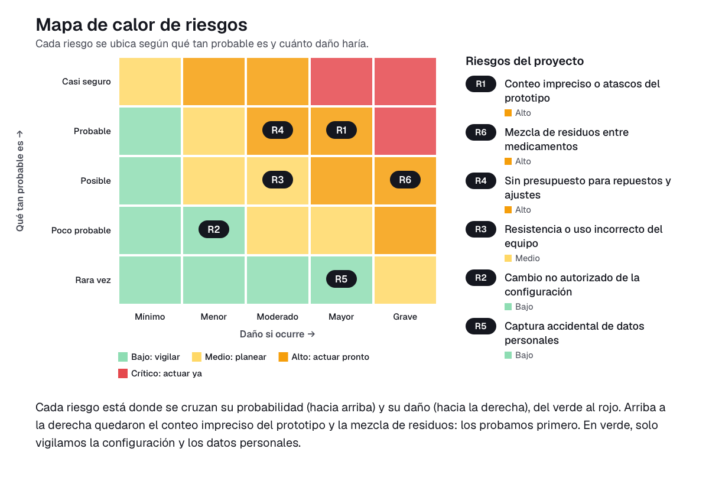

# 09. Gestión de riesgos

En este documento identificamos y valoramos los riesgos de implementar el contador robótico de pastillas con piezas impresas en 3D en la Droguería Medical 1. Cada riesgo se califica con la fórmula **nivel = probabilidad (P) × impacto (I)**, con valores de 1 a 5. Los niveles son: 1-4 bajo, 5-9 medio, 10-16 alto y 20-25 crítico.

Partimos de estas condiciones del proyecto:

- La solución no guarda datos.
- La usará a diario la administradora de la droguería.
- Contamos con un presupuesto de cero pesos.

## Matriz de riesgos

| ID | Riesgo | Categoría | P | I | Nivel | Tratamiento | Acción | Responsable | Fecha |
|---|---|---|---|---|---|---|---|---|---|
| R1 | Conteo impreciso o atascos del prototipo | Tecnológico | 4 | 4 | 16 (Alto) | Mitigar | Probar el prototipo con cada tipo de pastilla de uso frecuente y ajustar el canal de conteo hasta que la cantidad dispensada coincida con la solicitada. Mantener la verificación en pantalla por parte del auxiliar antes de empacar. | PR | 6 de noviembre |
| R2 | Cambio no autorizado de la configuración | Datos y ciberseguridad | 2 | 2 | 4 (Bajo) | Aceptar | Dejar el equipo en el mostrador, bajo supervisión de la administradora, y revisar la configuración al inicio de cada jornada. El sistema no almacena datos ni se conecta a redes externas. | LP | 12 de noviembre |
| R3 | Resistencia o uso incorrecto del equipo | Personas y adopción | 3 | 3 | 9 (Medio) | Mitigar | Hacer una capacitación práctica con la administradora y entregar una guía visual de un paso a paso con el flujo de uso. Recoger sus observaciones tras las primeras pruebas y ajustar la interfaz. | UX | 11 de noviembre |
| R4 | Sin presupuesto para repuestos y ajustes | Financiero | 4 | 3 | 12 (Alto) | Mitigar | Construir el prototipo con filamento y componentes ya disponibles, imprimir piezas de repuesto durante el desarrollo y documentar el ensamblaje para poder reparar el equipo sin costo. | LP | 5 de noviembre |
| R5 | Captura accidental de datos personales | Legal (Ley 1581 de 2012) | 1 | 4 | 4 (Bajo) | Evitar | Diseñar el sistema para que solo reciba medicamento y cantidad, sin campos de nombre, documento ni fórmula médica del cliente. Así no hay tratamiento de datos personales ni de salud, que son datos sensibles según la Ley 1581 de 2012. | AP | 10 de noviembre |
| R6 | Mezcla de residuos entre medicamentos | Operativo | 3 | 5 | 15 (Alto) | Mitigar | Definir un protocolo de limpieza del recipiente y del canal de conteo entre un medicamento y otro. Incluir una revisión visual antes de cada dispensación. | PR | 7 de noviembre |

## Riesgos altos y críticos: plan de respuesta

### R1. Conteo impreciso o atascos del prototipo (nivel 16, alto)

Es el riesgo central del proyecto, porque nuestra hipótesis depende de que el conteo sea más rápido y tenga menos errores que el manual. Si el prototipo falla, la solución no aporta valor y se mantienen las demoras en las filas.

- **Plan:** ejecutar pruebas repetidas con las pastillas de mayor rotación y registrar los aciertos y fallos de cada prueba.
- **Ajustes:** corregir el diseño de las piezas impresas según los resultados.
- **Control permanente:** el auxiliar verifica en pantalla la cantidad dispensada y, si no coincide, repite el conteo antes de empacar.

### R4. Sin presupuesto para repuestos y ajustes (nivel 12, alto)

Con un presupuesto de cero pesos, cualquier pieza dañada o ajuste adicional podría detener el proyecto.

- **Plan:** usar solo materiales y componentes ya disponibles.
- **Reposición:** imprimir piezas de repuesto durante el desarrollo.
- **Documentación:** dejar el ensamblaje documentado para que cualquier integrante pueda reparar el equipo sin gasto.
- **Alcance:** limitar el prototipo a las funciones esenciales de contar y entregar la dosis.

### R6. Mezcla de residuos entre medicamentos (nivel 15, alto)

Es el riesgo con mayor impacto, porque una pastilla que quede de un medicamento anterior puede llegar al cliente equivocado. En una droguería esto afecta la seguridad del paciente.

- **Plan:** establecer un protocolo corto de limpieza entre medicamentos.
- **Revisión:** hacer una inspección visual del recipiente antes de cada dispensación.
- **Pruebas:** incluir esta verificación en cada prueba del prototipo.
- **Orden de trabajo:** el protocolo debe quedar definido antes de cualquier uso real del equipo.

### Cómo leer el mapa de calor

Cada riesgo aparece en la casilla donde se cruzan qué tan probable es que ocurra (de abajo hacia arriba) y cuánto daño haría si ocurre (de izquierda a derecha). El color va del verde, que es zona tranquila, al rojo, que es zona urgente. En nuestro proyecto, lo más arriba y a la derecha quedó **Conteo impreciso o atascos del prototipo** y **Mezcla de residuos entre medicamentos**. Preocupan porque nuestra propuesta de valor es entregar la dosis exacta, y un error o una pastilla ajena afectaría directamente al cliente de la droguería. Por eso lo primero que haremos es probar el prototipo con las pastillas de mayor uso y definir el protocolo de limpieza. Muy cerca queda **Sin presupuesto para repuestos y ajustes**, que atendemos imprimiendo repuestos con material disponible. En la zona verde están **Cambio no autorizado de la configuración** y **Captura accidental de datos personales**: el equipo no guarda datos y está bajo supervisión de la administradora, así que basta con vigilarlos.

## Conclusión

Los riesgos más importantes son técnicos y operativos: que el conteo sea exacto y que no se mezclen medicamentos. Los atendemos con pruebas y un protocolo de limpieza, y los demás los controlamos con medidas sencillas y sin costo, antes del 18 de noviembre.

